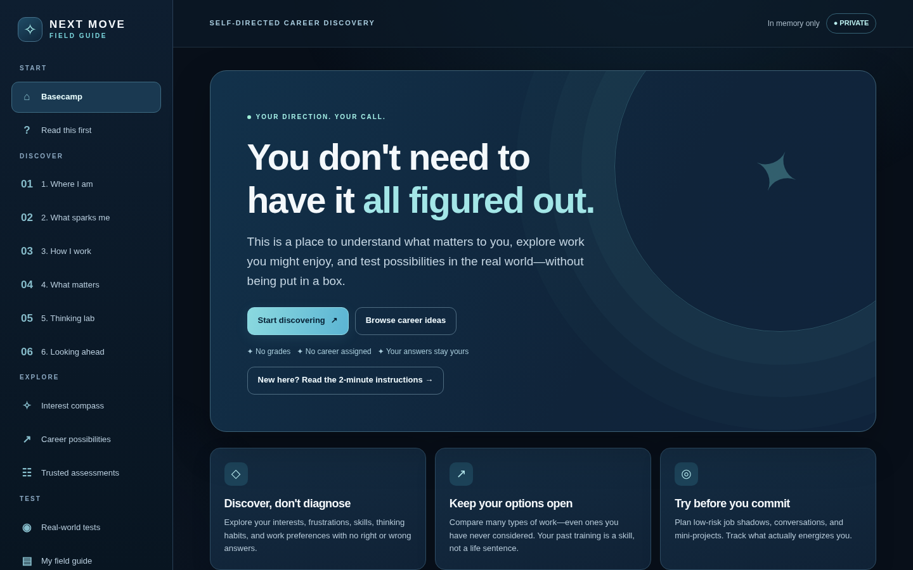

# Next Move — Career Discovery Field Guide

**Version 1.3.0 · A public-source career-exploration app from True North Data Strategies LLC**

Next Move helps adults think through career interests, values, transferable skills and possible next steps without assigning anyone a job. It includes original reflection prompts, six ungraded problem-solving exercises, a career explorer and short real-world experiments, plus the **published 2016 O*NET Mini Interest Profiler** (30 items, six RIASEC totals).



## Run it

1. Download the repository ZIP or clone it.
2. Open **`Next-Move.html`** in a modern browser (Chrome, Safari or Edge). No install, account, server, analytics or API key.
3. Choose whether to save responses on this device; saving is **OFF by default**.
4. Complete the original questions and the distinct O*NET Mini-IP section. Explore ideas and optional career experiments.
5. Review your report; print, export or share it **only if you choose**. Sharing opens your own email application; the app never sends email automatically.

The supplied HTML file works without internet. Official resource links and optional O*NET 31.0 JSON downloads need internet when you choose to use them. There is no live O*NET API connection.

## What's inside

| File | Purpose |
|---|---|
| `Next-Move.html` | Standalone, offline-capable app |
| `src/` | HTML shell, styles, original questions, O*NET 2016 activity set, app logic |
| `scripts/build.py` | Builds standalone HTML from source (Python 3, no deps) |
| `scripts/build.mjs` | Node.js alternative builder |
| `scripts/make_edition.py` | Optional generator for private personal editions; **do not commit generated personal copies** |
| `tests/` | Synthetic functional and assessment tests (browser tests require Playwright + Chromium) |
| `docs/` | End-user guide, architecture, privacy, source attribution and public-release notes |
| `LICENSE.md` | Separate licensing boundaries for TNDS and O*NET content |
| `THIRD_PARTY_NOTICES.md` | O*NET source, attribution, rights, and version limitations |

## Build and test

```bash
python3 scripts/build.py
node --check src/data.js
node --check src/app.js
python3 tests/test_public_static.py
# Optional browser tests with Playwright installed and Chromium available:
python3 tests/smoke_test.py
python3 tests/test_onet_v130.py
```

The browser-test scripts assume Chromium at `/usr/bin/chromium` and can be adapted to another local installation. Tests are synthetic and must not contain real participant responses.

## Privacy and limitations

- Personal answers stay in browser memory unless device saving is intentionally enabled. Local device storage is **not encrypted**.
- No external AI service or tracking. User-initiated official URLs open a new tab and may have their own privacy terms.
- The O*NET portion uses the **2016 published Mini-IP item bank**, not necessarily the updated current official site assessment.
- The O*NET section is a research-based interest exploration instrument. The separate TNDS questionnaire and career ordering are **not validated measures or official O*NET occupation matches**.
- Optional O*NET 31.0 occupation files are downloaded and locally imported by the user; no live web service or occupation dataset is bundled here.
- Not designed for diagnosis, hiring decisions, aptitude certification, or guaranteed career outcomes.


## Maintaining this public repository

- [Release history](CHANGELOG.md) tracks what changed between versions.
- [Public release checklist](docs/PUBLIC_RELEASE_CHECKLIST.md) explains the
  source review, privacy, attribution, and release steps.
- [Report a bug](.github/ISSUE_TEMPLATE/bug_report.yml) or propose a feature
  using **fabricated examples only**. Never publish personal questionnaires.
- [Community conduct](CODE_OF_CONDUCT.md) applies to public discussion.
- [Security policy](SECURITY.md) explains the privacy boundaries.
- [Contributions](CONTRIBUTING.md) require owner approval; visible source is
  not an open-source grant.

## License and O*NET attribution

**Public GitHub visibility is not an open-source license.** Original TNDS code and content are currently **all rights reserved**, pending a separate owner license decision. The embedded O*NET source content is separately licensed under the [O*NET Tools Developer License](https://www.onetcenter.org/license_toolsdev.html); do not treat it as TNDS proprietary material. See `LICENSE.md` and `THIRD_PARTY_NOTICES.md` for full details.

> This application includes information from the O*NET Career Exploration Tools by the U.S. Department of Labor, Employment and Training Administration (USDOL/ETA), used under the O*NET Tools Developer License. O*NET® is a trademark of USDOL/ETA. USDOL/ETA has not approved, endorsed, or tested the Next Move application.

**Status:** Public-source repository package prepared; NOT published to GitHub automatically. No hosted email, live O*NET API or store checkout has been deployed.
