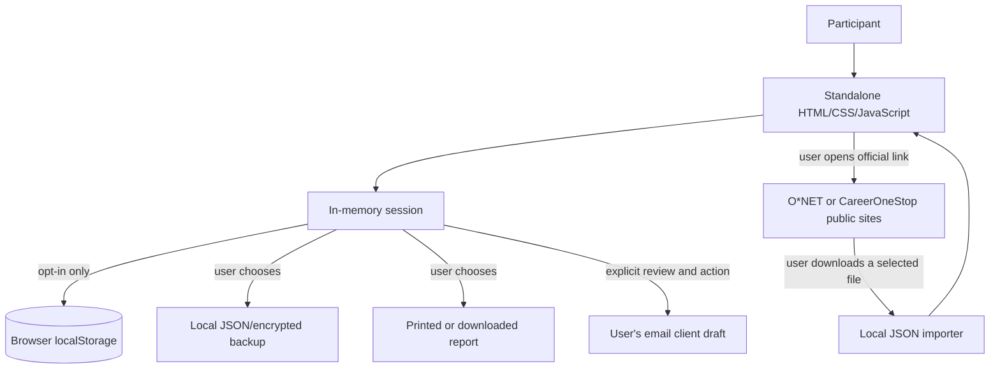

# Architecture — Next Move v1.3.0

## Purpose
A local-first standalone browser application for career exploration with the published 2016 O*NET Mini-IP.

- No analytics, no LLM, no server endpoint, no embedded API key; the offline Content Security Policy blocks network connections.
- O*NET published 2016 questions and their scoring sit in `src/data.js` and `src/app.js`, distinctly separated from TNDS-created prompts.
- The O*NET 31.0 database is not shipped with the app. Imported official records are displayed as an illustrative local browser; the TNDS ordering is not a validated occupational match.
- Use `scripts/build.py` to regenerate `Next-Move.html` from `src/` after any change.
- Do not add direct client-side O*NET Web Services keys. Future remote integrations require separate security and license review.

## Source map

| File | Purpose |
|---|---|
| `src/index.html` | Standalone shell, security policy, navigation regions |
| `src/data.js` | Original prompt bank, career examples, 2016 Mini-IP activity bank |
| `src/app.js` | State, questionnaires, scoring, exploration, consent, report, export |
| `src/styles.css` | Responsive layout and print presentation |
| `scripts/build.py` | Offline bundler, using only Python 3 standard library |
| `scripts/make_edition.py` | Optional private-edition generator; never collects responses |
| `tests/` | Browser and static checks with synthetic data |
